<p align="center"></p>

<h1 align="center">Jay-S</h1>

<p align="center"><strong>Study with real exams and your own material, next to an AI that runs on your computer.</strong></p>

<p align="center">
  <a href="https://github.com/TyxMatty/Jay-S/actions/workflows/ci.yml"></a>
</p>

<p align="center"><strong>English</strong> · <a href="README.pt-BR.md">Português</a></p>

<p align="center">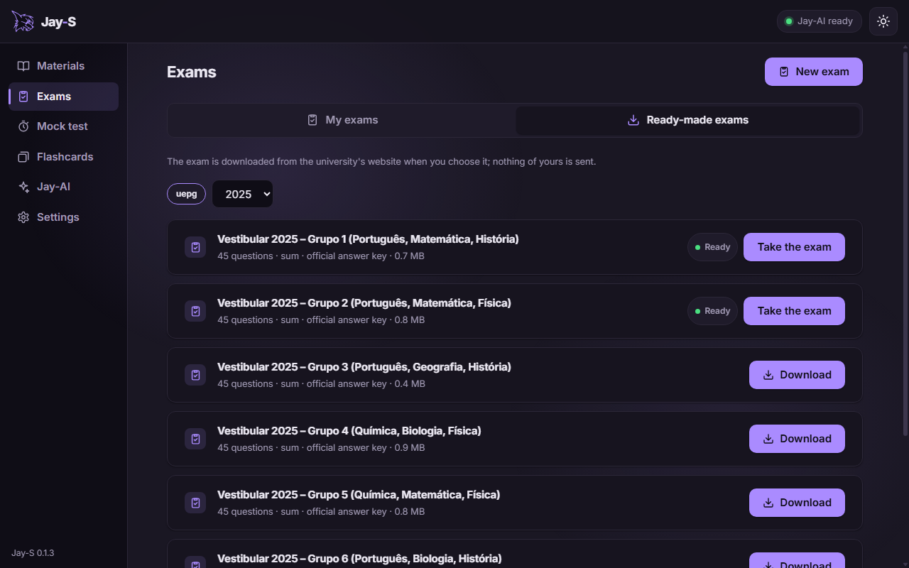</p>

Jay-S is the study app of the Jay line, for Windows. Take a real entrance exam, or attach your handouts and exams and let **Jay-AI** build exams in the style you pick (ENEM, UEPG, UEM, UNICENTRO…). Answer them in the app, in exam mode or in a learning mode that shows each answer at once, or against the clock as a mock test; then keep going with explanations and flashcards. Jay-AI is a language model that runs on your own computer: your files and answers never leave it.

## Ready-made exams

The UEPG Vestibular 2025 exams come ready to take, each with its **official answer key**. Press Download and Jay-S fetches the PDF from the university's website, checks it and splits it into questions. Nothing of yours is sent.

## Every question with its text, and the original page

Questions keep their base text, and **See in the original exam** opens the real PDF pages the question is on, for when a formula, table or figure didn't survive the conversion to text.

<table>
  <tr>
    <td>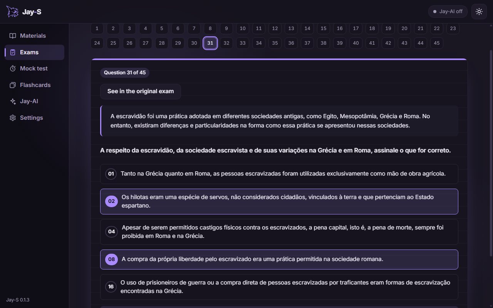</td>
    <td>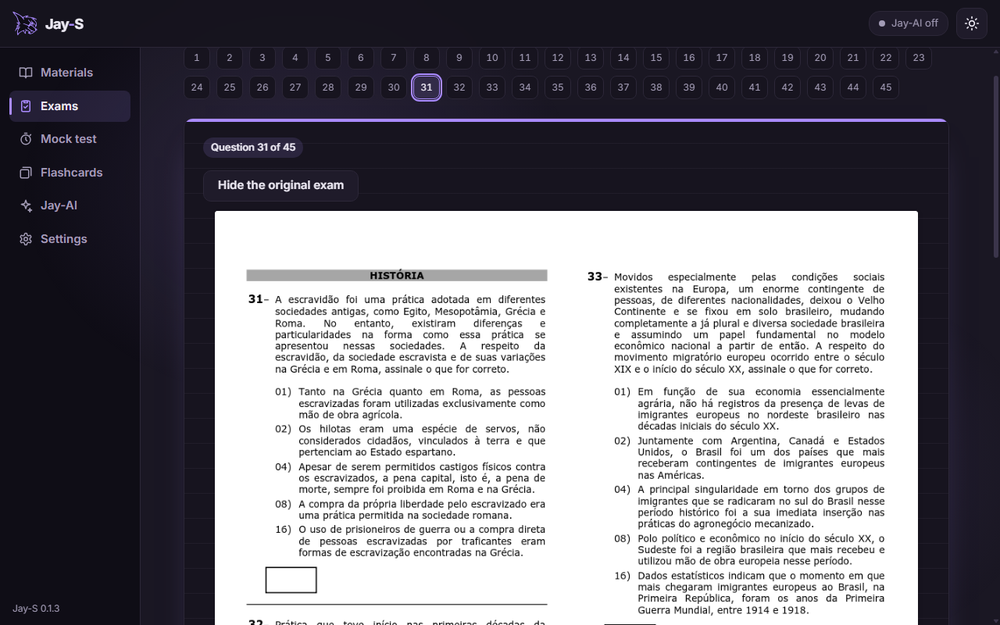</td>
  </tr>
</table>

## Jay-AI looks at your result

When you finish, Jay-S grades the exam with the key, question by question (sum-type questions get partial credit), and sends the result to Jay-AI, which writes what went well, what to review and what to do next.

<p align="center">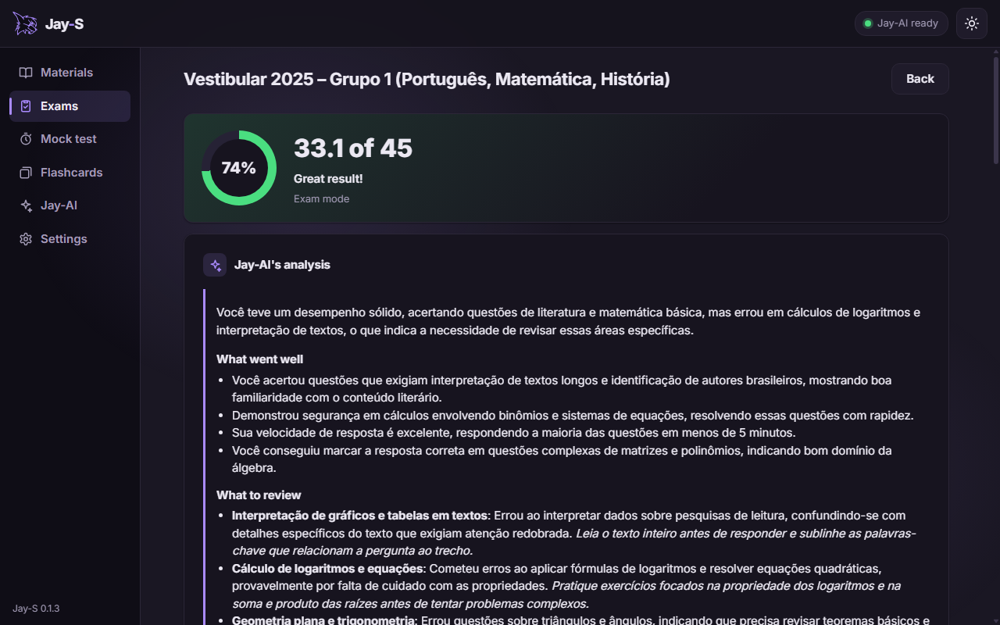</p>

The analysis is the model's reading of your answers, not a grade: like any language model, it can get details wrong.

## A chat that computes

Ask Jay-AI about anything, about your materials, or about an exam you took. When the question is a calculation, Jay-AI picks the formula and **Jay-S does the arithmetic**: every number is computed by the app, and for a hypothesis test the decision (reject H0 or not) is the app's comparison of the statistic with the critical value. The reply says so with a "Computed by the app" badge, and asks you to check the formula against your material. (In the picture, Jay-AI wrote the steps in Portuguese.)

<p align="center">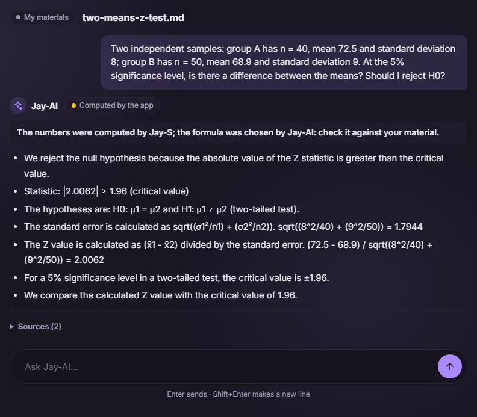</p>

## Explanations and flashcards

**Explain** turns a handout into a short text, key points and concept cards, in the language and depth you choose, then asks you questions to see what stuck. Flashcards come from your material and space themselves out as you rate them; a rating can be undone, and each session ends with a summary.

<table>
  <tr>
    <td>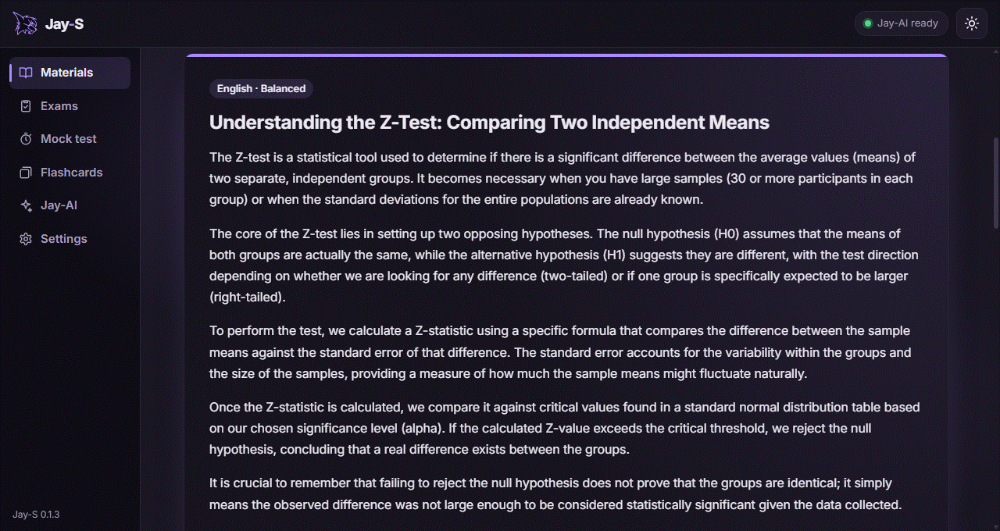</td>
    <td>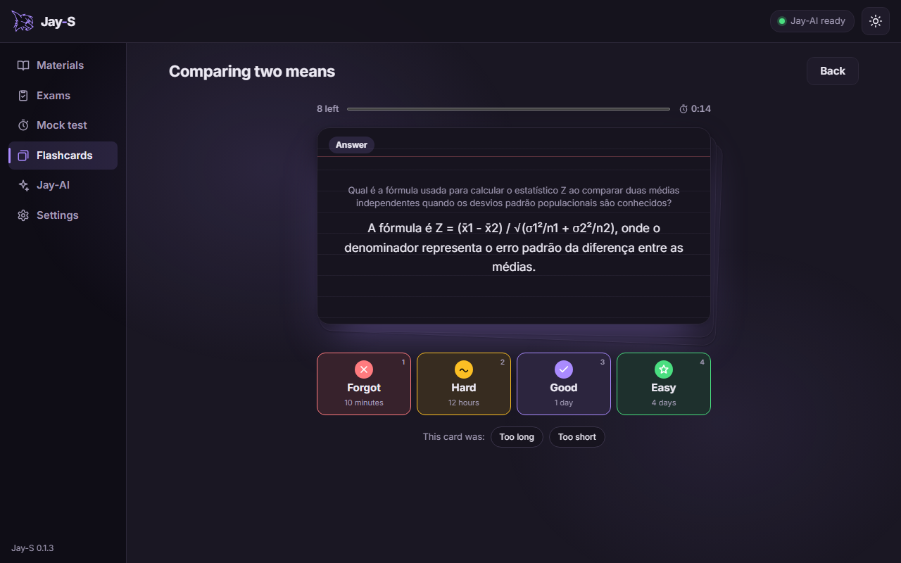</td>
  </tr>
</table>

## Three styles, light and dark

Calm, Neon and Soft, each in a light and a dark theme.

<table>
  <tr>
    <td>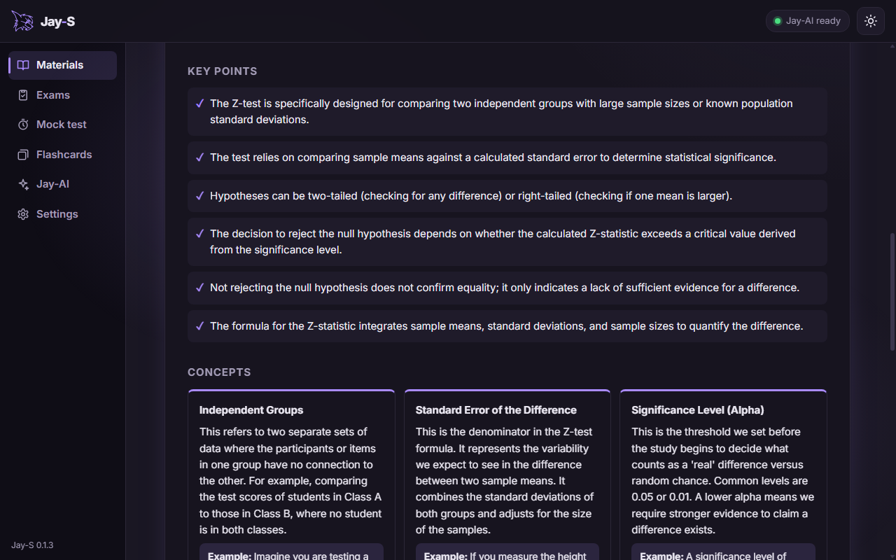</td>
    <td>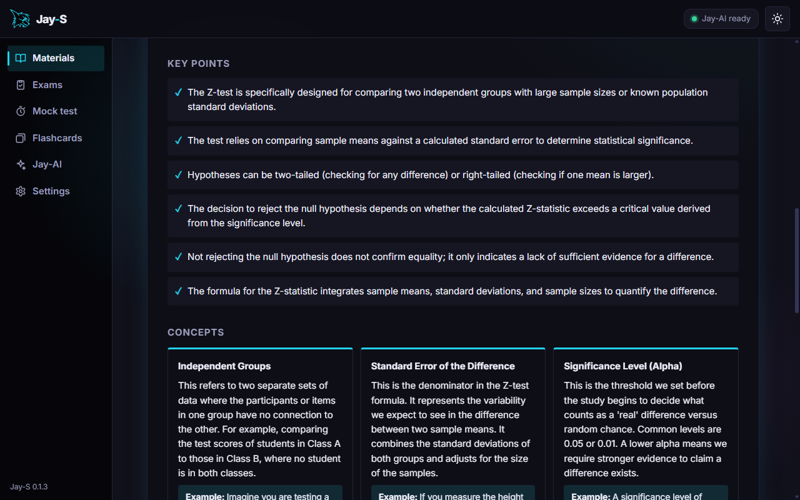</td>
    <td>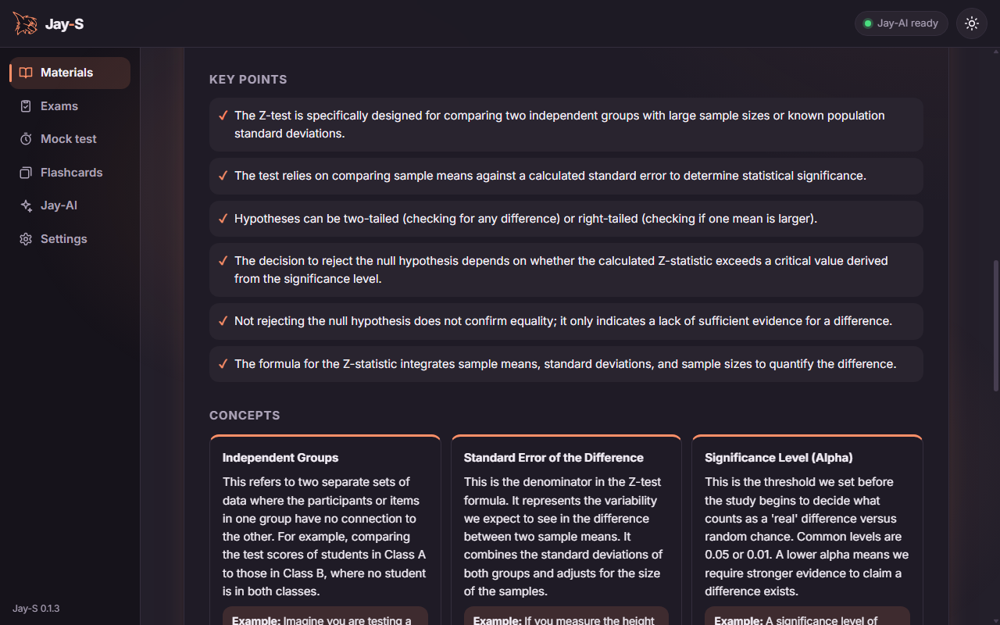</td>
  </tr>
  <tr align="center"><td>Calm</td><td>Neon</td><td>Soft</td></tr>
</table>

<p align="center">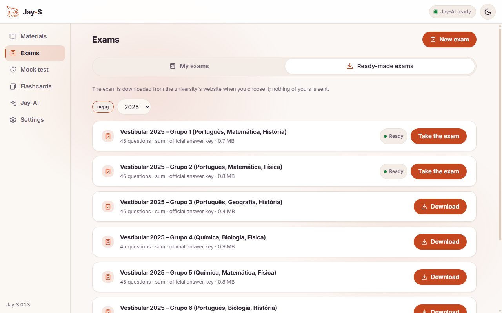</p>


## Private by design

Everything runs on your computer: the app, Jay-AI and your data. Jay-S uses the network for three things only:

- **Jay-AI's download**, once, when you turn it on: its runtime and the model (1.3 or 2.7 GB).
- **A ready-made exam**, when you press its Download button, from the university's website.
- **The update check**, once per start, against this repository's releases; an update installs only when you click it.

Text from your files and from the model is shown as text, never as page code, and the page never handles file paths. The security review is in [docs/SEGURANCA.en.md](docs/SEGURANCA.en.md).

It is also light: with Jay-AI idle, the release build measured about 110 to 120 MB of private memory, and Jay-AI leaves the memory 2 minutes after its last use.

## Download

Download `Jay-S_<version>_x64-setup.exe` from the **[latest release](https://github.com/TyxMatty/Jay-S/releases/latest)** (Windows, 64-bit). Jay-AI is not in the installer: you download it in the app, in the Jay-AI section. Every version is listed under [releases](https://github.com/TyxMatty/Jay-S/releases).

## Code

Tauri v2 with vanilla JavaScript for the interface (`frontend/`) and a Rust engine (`crates/jay-study`); Jay-AI is `llama-server` from llama.cpp, run as a child process. The plan, the stages and what was measured are in [docs/ARQUITETURA.en.md](docs/ARQUITETURA.en.md).

```powershell
npm install
npm run dev    # the app (Tauri), Vite on port 5178
npm run web    # just the interface, in a browser
npm test
```

License: MIT.
