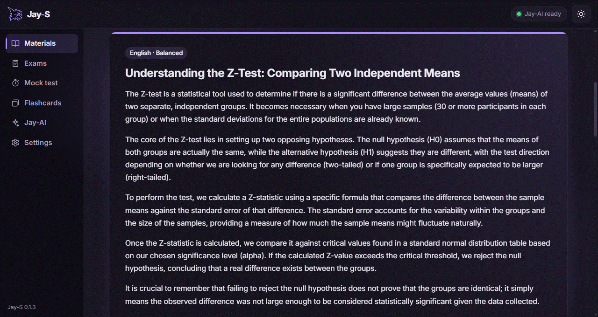
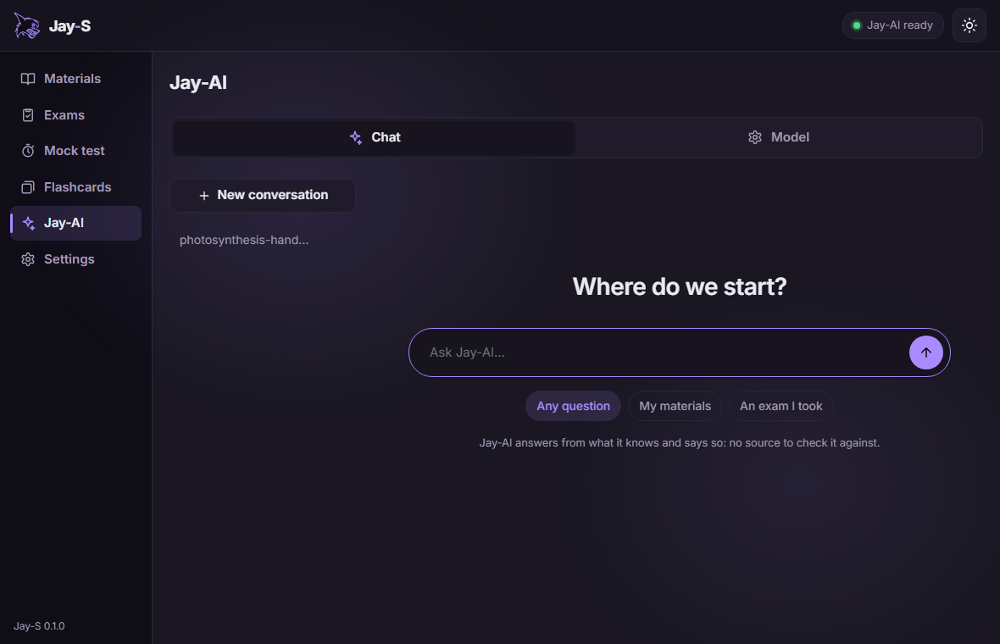
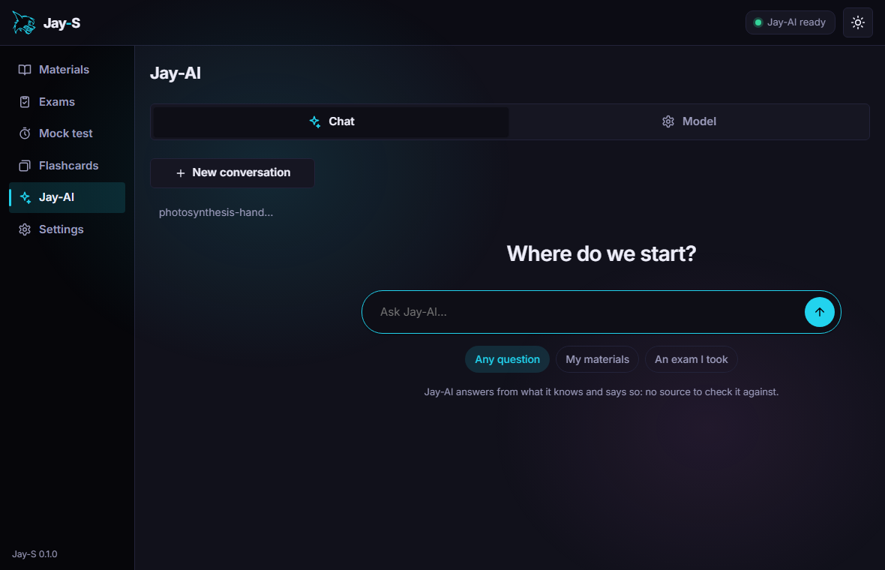
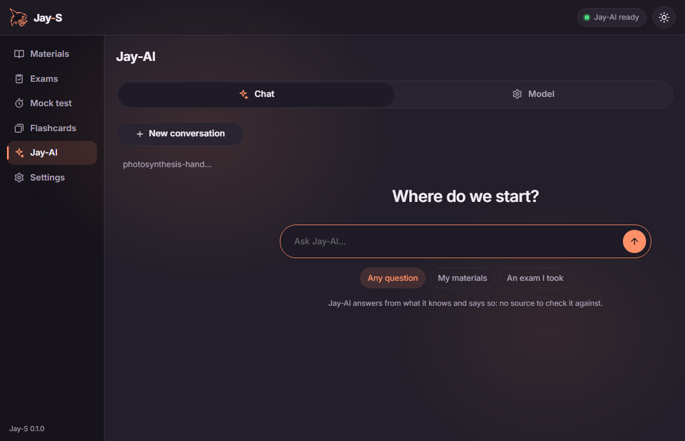

# Jay-S

[](https://github.com/TyxMatty/Jay-S/actions/workflows/ci.yml)

[English](README.md) · **Português**

O app de estudos da linha Jay: anexe seu conteúdo e suas provas, e o **Jay-AI**, um modelo que roda no seu computador, monta provas no estilo que você escolher (ENEM, UEPG, UEM, UNICENTRO…) que você faz no próprio app (marcando X ou somatória, com um modo aprender que mostra cada resposta na hora), simulados com tempo e flashcards que se adaptam a você. Seus arquivos não saem do computador.

<p align="center"></p>

<table>
  <tr>
    <td></td>
    <td></td>
    <td></td>
  </tr>
  <tr align="center"><td>Calmo</td><td>Neon</td><td>Suave</td></tr>
</table>

## Baixar

Baixe o `Jay-S_<versão>_x64-setup.exe` da **[última release](https://github.com/TyxMatty/Jay-S/releases/latest)** (Windows, 64 bits). O Jay-AI não vem no instalador: o programa e o modelo dele (1,3 ou 2,7 GB) são baixados uma vez, quando você liga o Jay-AI no app. Todas as versões estão em [releases](https://github.com/TyxMatty/Jay-S/releases).

O plano, as etapas e o que foi medido estão em [docs/ARQUITETURA.md](docs/ARQUITETURA.md). A revisão de segurança (fronteiras de confiança, CWEs e OWASP LLM, Semgrep, achados em aberto) está em [docs/SEGURANCA.md](docs/SEGURANCA.md).

## Código

```powershell
npm install
npm run dev    # o app (Tauri), Vite na porta 5178
npm run web    # só a interface no navegador
npm test
```

Licença: MIT.
